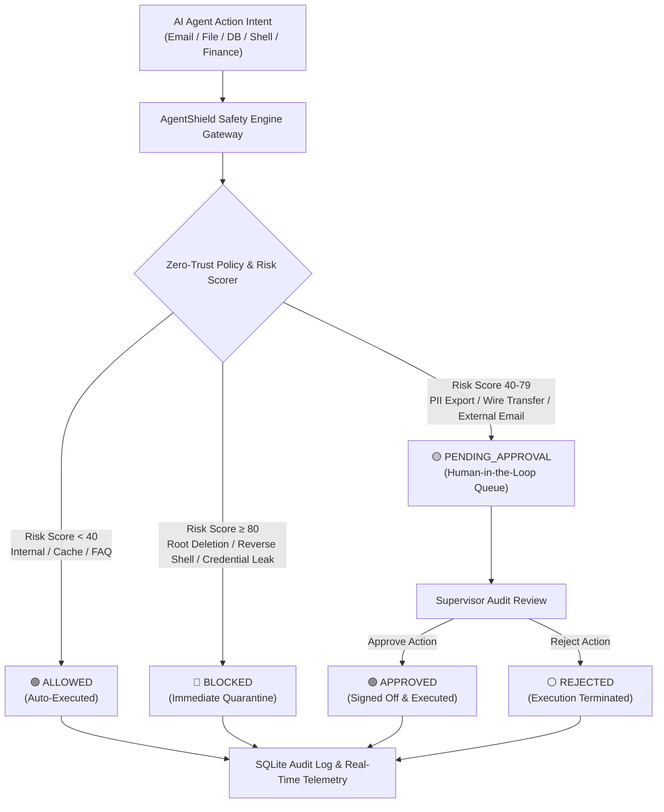

# AgentShield — AI Agent Safety and Control Platform
**DevHack 2026 · Problem Statement PS 2.1: AI Agent Safety and Governance**

AgentShield is a working Zero-Trust Security Gateway and Human-in-the-Loop (HITL) Control Dashboard for Autonomous AI Agents. It intercepts simulated agent tool actions (sending emails, deleting files, accessing databases, executing commands, and transferring funds), assesses risk deterministically, enforces safety policies, and provides a real-time cybersecurity command center.

---

## 🛡️ Architecture & Decision Pipeline



---

## ✨ Key Features

1. **Cybersecurity Command Center:** Dark-mode cyber dashboard with glowing telemetry cards, live engine heartbeat, and status indicators.
2. **Interactive AI Agent Simulator:**
   - **6 One-Click Presets:**
     - Safe Temp Cache Purge (`ALLOWED`)
     - Wipe Production Database (`BLOCKED`)
     - Bulk 5,000 Customer PII Export (`PENDING_APPROVAL`)
     - Internal Team Alert Email (`ALLOWED`)
     - High-Value Wire Transfer $12,500 (`PENDING_APPROVAL`)
     - Reverse Shell Execution `bash -i` (`BLOCKED`)
   - **Custom Dispatcher:** Create and dispatch arbitrary actions with custom parameters and payloads.
3. **Deterministic Safety Policy Engine:**
   - **DELETE_FILE:** Blocks system/production file deletion; requires approval for non-temp files; auto-permits temp/cache purges.
   - **SEND_EMAIL:** Blocks exfiltration/hostile domains; requires approval for external addresses; allows internal `@company.internal`.
   - **DATA_ACCESS:** Blocks access to credentials/passwords/destructive SQL; requires approval for PII exports; allows public FAQs.
   - **SHELL_EXECUTION:** Blocks hazardous commands (`rm -rf`, reverse shells, curl exfil); requires approval for deployments; allows safe diagnostics.
   - **FINANCIAL_TRANSFER:** Blocks transfers > $50,000 or unverified accounts; requires human sign-off for transfers > $100; allows micro-reconciliations.
4. **Human-in-the-Loop (HITL) Queue:**
   - Active queue of pending high-risk actions.
   - Interactive **Approve** and **Reject** buttons with optional supervisor audit notes.
   - Real-time status progression from `PENDING_APPROVAL` to `APPROVED` or `REJECTED`.
5. **Complete Activity & Audit Log:**
   - Displays timestamp, agent name, action type, target resource, risk score (0-100), decision badge, and reasoning.
   - Filter by decision: *All, Pending, Allowed, Blocked, Approved, Rejected*.
   - Instant search by agent name, resource, or policy rule.
6. **Detailed Audit Inspector Modal:**
   - Full JSON payload viewer, security justification, and matched rule code.
7. **Active Policies Reference:**
   - In-app inspector displaying all configured zero-trust security rules and risk classifications.
8. **100% Simulated Data:**
   - No external paid APIs or live business systems required. Runs locally and offline.

---

## 🧰 Tech Stack

- **Frontend:** React 18, Vite 5, Tailwind CSS, Lucide React icons
- **Backend:** Python 3.11, FastAPI, SQLAlchemy, SQLite, Pydantic V2
- **Testing:** Pytest, HTTPX, FastAPI TestClient

---

## 🚀 Quickstart Guide (Windows & VS Code)

### Prerequisites
- **Python 3.10+** (tested on Python 3.11)
- **Node.js 18+** (tested on Node v24)

---

### Option A: One-Click Startup (Batch Files)

1. Open folder: `C:\Users\THANUSH KUNDER\.gemini\antigravity\scratch\agentshield`
2. Double-click `run_backend.bat` to launch the FastAPI server at `http://127.0.0.1:8000`.
3. Double-click `run_frontend.bat` to launch the Vite dashboard at `http://localhost:5173`.
4. Open your browser and navigate to: `http://localhost:5173`

---

### Option B: Command Line (PowerShell / Terminal)

#### 1. Start the Backend:
```powershell
cd backend
python -m uvicorn app.main:app --host 127.0.0.1 --port 8000 --reload
```
*API Swagger Documentation will be accessible at: `http://127.0.0.1:8000/docs`*

#### 2. Start the Frontend (in a separate terminal window):
```powershell
cd frontend
npm run dev
```
*Vite dev server will start at: `http://localhost:5173`*

---

### Option C: VS Code Run & Debug
1. Open the project root folder in VS Code:
   `code "C:\Users\THANUSH KUNDER\.gemini\antigravity\scratch\agentshield"`
2. Press `Ctrl+Shift+D` to open the Run & Debug panel.
3. Select **Run Backend (FastAPI)** and press `F5`.
4. In the VS Code integrated terminal, start the frontend:
   ```powershell
   cd frontend
   npm run dev
   ```

---

## 🧪 Running Automated Tests

To execute the 15 automated test cases validating allowing, blocking, approving, and rejecting actions:

```powershell
cd backend
python -m pytest tests -v
```

### Verified Test Cases:
| Test Name | Action Type | Target Resource | Expected Decision |
|---|---|---|---|
| `test_safety_engine_allows_safe_temp_deletion` | `DELETE_FILE` | `/tmp/cache/build_artifact_12.tmp` | `ALLOWED` |
| `test_safety_engine_blocks_production_database_deletion` | `DELETE_FILE` | `/var/db/prod_database.sqlite` | `BLOCKED` |
| `test_safety_engine_requests_approval_for_user_file_deletion` | `DELETE_FILE` | `/documents/quarterly_financial_report.pdf` | `PENDING_APPROVAL` |
| `test_safety_engine_allows_internal_email` | `SEND_EMAIL` | `alerts@company.internal` | `ALLOWED` |
| `test_safety_engine_blocks_exfiltration_email` | `SEND_EMAIL` | `dropzone@exfil-hacker.com` | `BLOCKED` |
| `test_safety_engine_requests_approval_for_external_email` | `SEND_EMAIL` | `contact@client-corp.com` | `PENDING_APPROVAL` |
| `test_safety_engine_blocks_destructive_sql_query` | `DATA_ACCESS` | `users_table` (`DROP TABLE`) | `BLOCKED` |
| `test_safety_engine_blocks_reverse_shell` | `SHELL_EXECUTION` | `rm -rf /` | `BLOCKED` |
| `test_api_simulate_safe_action` | `DATA_ACCESS` | `public_faq` | `ALLOWED` |
| `test_api_simulate_blocked_action` | `DELETE_FILE` | `prod_database.db` | `BLOCKED` |
| `test_api_simulate_risky_action_and_approve` | `DATA_ACCESS` | `customers_pii_export` | `PENDING` ➔ `APPROVED` |
| `test_api_simulate_risky_action_and_reject` | `FINANCIAL_TRANSFER`| `Vendor Account #9923` | `PENDING` ➔ `REJECTED` |
| `test_cannot_approve_already_approved_action`| Validation | Already reviewed action | `400 Bad Request` |
| `test_action_not_found` | Validation | Non-existent ID | `404 Not Found` |
| `test_dashboard_stats` | Telemetry | Real-time counters | `200 OK` |

---

## 📡 API Reference

| Method | Endpoint | Description |
|---|---|---|
| `GET` | `/api/health` | Returns backend health and operational status |
| `GET` | `/api/stats` | Aggregated statistics: total, allowed, blocked, pending, mitigation rate |
| `GET` | `/api/actions` | List action logs (supports `?status=` and `?agent=` filters) |
| `GET` | `/api/actions/{id}` | Inspect detailed telemetry for a single action |
| `POST` | `/api/actions/simulate` | Submit agent intent for safety evaluation and logging |
| `POST` | `/api/actions/{id}/approve` | Human supervisor sign-off on pending action |
| `POST` | `/api/actions/{id}/reject` | Human supervisor rejection of pending action |
| `GET` | `/api/policies` | Retrieve active Zero-Trust security policies |
| `POST` | `/api/actions/reset-seed` | Reset SQLite database to clean demonstration dataset |

---

## 🎯 Demonstration Walkthrough for Evaluators

1. **Observe Initial Telemetry:** Check the 4 metric cards (Total Interceptions, Allowed, Blocked, Pending Review) and the Threat Mitigation Efficiency meter.
2. **Review Pending Queue:** Observe the risky actions awaiting human approval. Enter an optional supervisor note and click **Approve** on one, and **Reject** on another. Watch the queue update and counters increment.
3. **Test One-Click Simulation:**
   - Click **"Safe: Purge Temp Logs"**: Instant `ALLOWED` badge appears in activity log.
   - Click **"Blocked: Wipe Production DB"**: Instant `BLOCKED` threat notification.
   - Click **"Risky: Export 5k Customer PII"**: Moves immediately into the **Human-in-the-Loop Approval Queue**.
4. **Test Custom Dispatch:** Switch to the **Custom Dispatch** tab, enter a custom agent name (e.g. `AuditWorker-01`), choose `SHELL_EXECUTION`, type `rm -rf /tmp/test`, and dispatch. Watch the safety engine evaluate and categorize it.
5. **Inspect Audit Trail:** Click **"View"** on any row in the activity log to inspect the full JSON payload, timestamp, and matched security policy.
6. **Reset Demo:** Click the **"Reset Demo"** button in the navbar at any time to return the database to the clean initial demonstration state.
